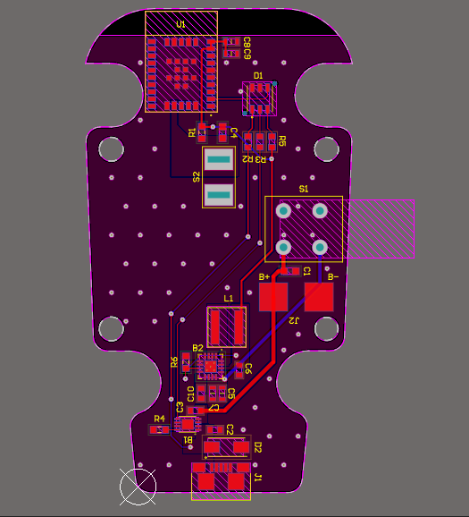

# BLE NTC Temperature Sensor (NINA-B112)

Battery-powered Bluetooth LE temperature sensor built around the u-blox
NINA-B112 module (nRF52832). A Honeywell T7335 NTC probe sticks out of the
bottom of a Hammond 1553 handheld enclosure; the board charges its Li-Po cell
from micro-USB and reports the temperature over BLE.

| 3D view | 2D layout |
| --- | --- |
| [](images/pcb-3d-view.png) | [](images/pcb-layout-2d.png) |

| Enclosure, open | Enclosure, bottom | Enclosure, side (NTC probe) |
| --- | --- | --- |
| [](images/enclosure-open-top-view.png) | [](images/enclosure-bottom-view.png) | [](images/enclosure-side-view.png) |

## On the board

| Ref | Part | Role |
| --- | --- | --- |
| U2 | NINA-B112-00B-00 | BLE module (nRF52832) |
| S1 | Honeywell T7335 D1008 | NTC temperature probe |
| U1 | MCP73831T-2ACI/MC | Single-cell Li-Po charger |
| J3 | Battery pads | Li-Po cell (`BAT+`, `BAT-`) |
| U4, L2 | TPS62132 + 2.2 µH (XAL5030) | Buck converter |
| J1, D2 | Amphenol GMCBA058211230HHR micro-USB + SMA6J5.0CA TVS | Charging input with surge protection |
| Q1 | NX3008NBK | N-MOSFET |
| D1 | Würth 150353M153300 | RGB status LED |
| S2 | E-Switch 800CSP1B6M6QE | SPDT push button |
| J2 | Würth 61300621121, 2×3 header | Programming header |

## Firmware

`firmware/` holds an nRF5 SDK project. `main.c` samples the NTC divider on
`AIN0` every 5 s, converts it to a temperature, and publishes it through a custom
BLE temperature service (`ble/ble_temp_service.c`) under the device name
`BLE-NTC`.

## Repository layout

```
0010_ble_ntc/
├── PCB/                               # Altium Designer project
│   ├── BLE-NTC.PrjPCB                 # Project file (open this)
│   ├── BLE-NTC.SchDoc                 # Schematic
│   ├── BLE-NTC.PcbDoc                 # PCB layout
│   ├── BLE-NTC.PCBDwf                 # Draftsman drawing
│   ├── OutJob.OutJob, BLE-NTC.OutJob  # Output jobs
│   └── Project Outputs for BLE-NTC/   # PDFs, BOM and STEP exports
├── mechanical/                        # SolidWorks enclosure (Hammond 1553AA)
│   ├── Assem2.SLDASM                  # Enclosure + PCB assembly
│   ├── Assem2 -nopcb.SLDASM           # Enclosure without the PCB
│   ├── Assembly_without_PCB.SLDDRW    # Assembly drawing
│   ├── *.SLDPRT                       # Enclosure, probe, switch, battery and screw models
│   └── drawings/                      # PDF export of the assembly drawing
├── firmware/                          # nRF5 SDK firmware
└── images/                            # Renders used in this README
```

## Component library

This repo stores no libraries. Every part comes from the general Altium library
in [Gueni/0000_libraries](https://github.com/Gueni/0000_libraries):

| File | Used for |
| --- | --- |
| [`Altium/DATABASE.DbLib`](https://github.com/Gueni/0000_libraries/blob/master/Altium/DATABASE.DbLib) | Database library the schematic components link to |
| [`Altium/DB.mdb`](https://github.com/Gueni/0000_libraries/blob/master/Altium/DB.mdb) | Parts database (part numbers, MPNs, suppliers) |
| [`Altium/SCH.SchLib`](https://github.com/Gueni/0000_libraries/blob/master/Altium/SCH.SchLib) | Schematic symbols |
| [`Altium/FTP.PcbLib`](https://github.com/Gueni/0000_libraries/blob/master/Altium/FTP.PcbLib) | PCB footprints and 3D models |

### Setup

The project finds the library through a relative path, so clone both repos side
by side in the same workspace folder:

```
WORKSPACE/
├── 0000_libraries/                   # git clone https://github.com/Gueni/0000_libraries.git
└── 0010_ble_ntc/                     # this repo
```

The project file references `..\..\0000_libraries\Altium\DATABASE.DbLib` and
adds `..\..\0000_libraries\Altium\` as a library search path. The DbLib's
database path is absolute (`D:\WORKSPACE\0000_libraries\Altium\DB.mdb`); see the
[library README](https://github.com/Gueni/0000_libraries#setup) if your
workspace lives elsewhere.
